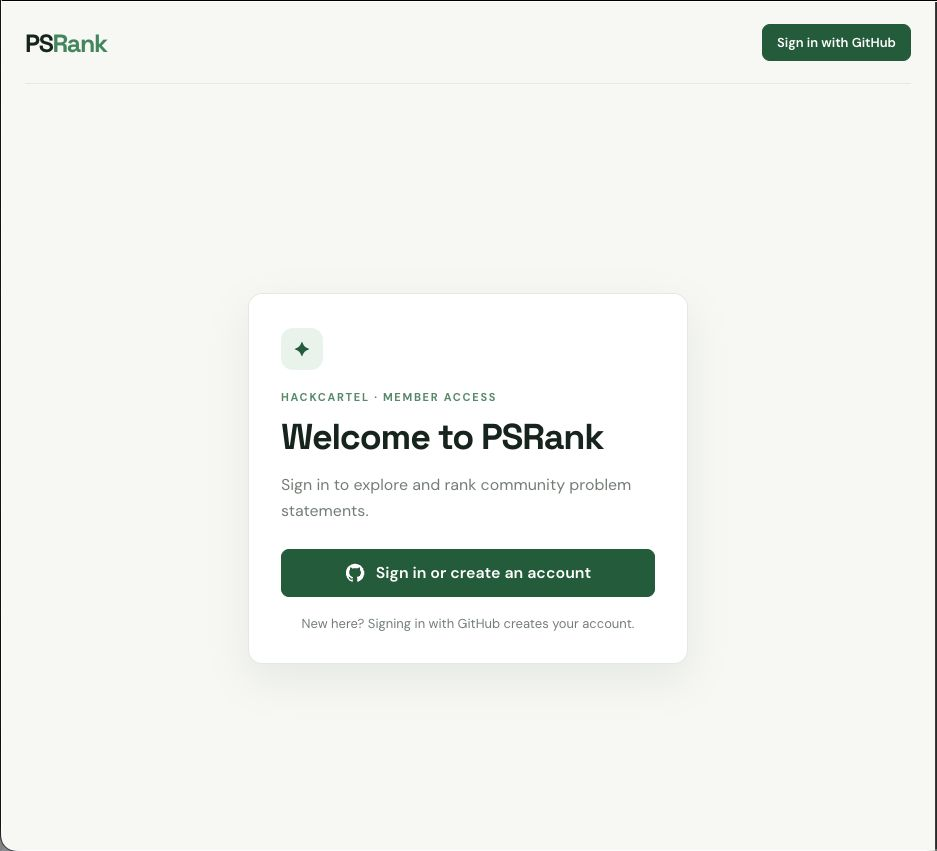
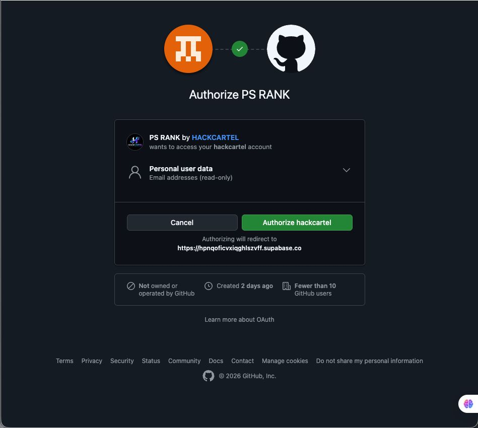
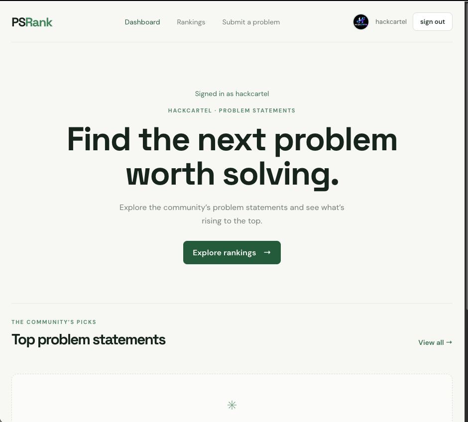
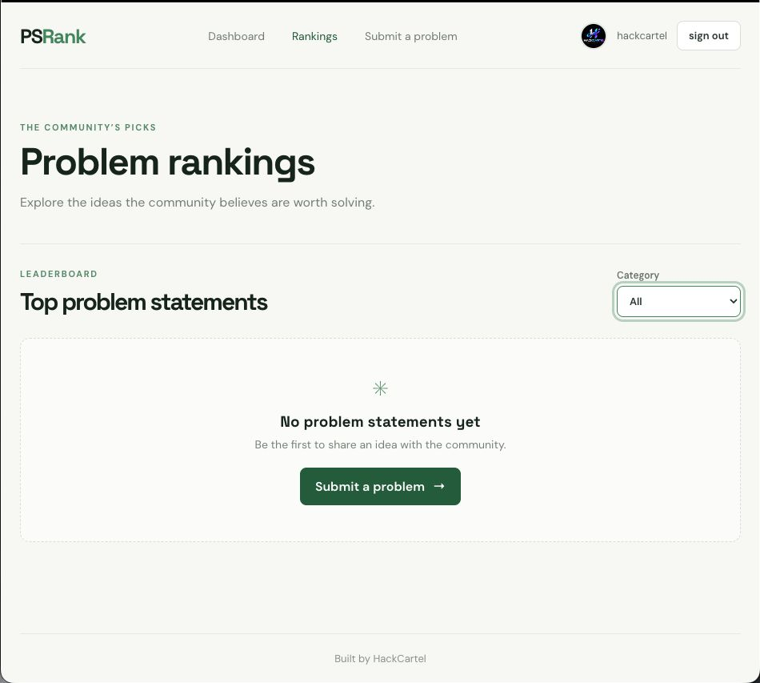
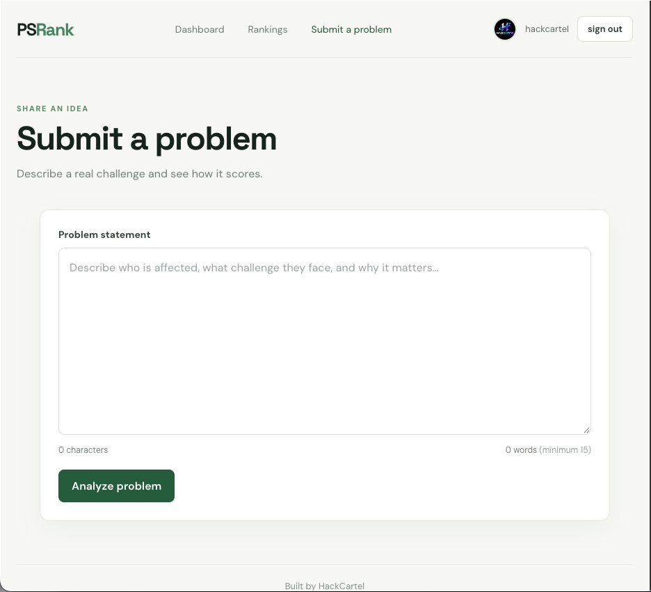
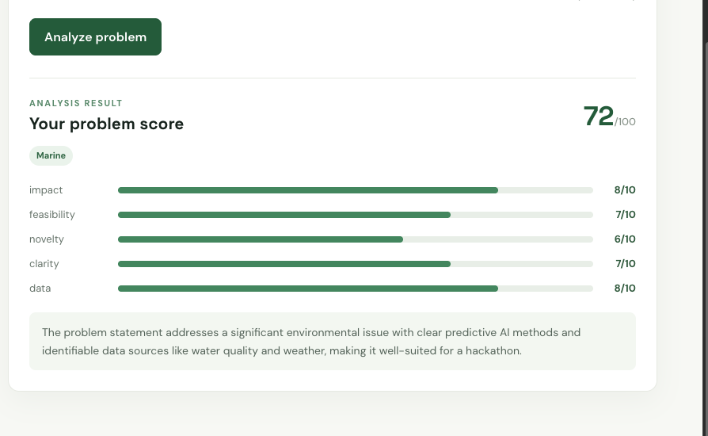

## Contributor

Raj

## Scope

Dashboard interface and member login screen for the PSRank internal hackathon platform.

## Stack

- React with Vite
- Supabase Auth (email and password sign-in integration started)

## Frontend work completed

- Created the React + Vite app.
- Built the PSRank dashboard UI with navigation, welcome section, and rankings placeholder.
- Built the member login form.
- Connected the login form to Supabase `signInWithPassword` and added loading/error feedback.
- Added session-aware user display and logout handling in the frontend code; successful sign-in/logout still need a dry run after the invite setup is resolved.

## Screenshots received

The following screenshots :

## Dry-run status

| Flow | Status | Evidence |
| --- | --- | --- |
| Signed-out dashboard renders | Captured | Dashboard screenshot above |

| Login screen renders | Captured | Login screenshot above |

| Successful member sign-in | Pending | Supabase invitation/password/redirect setup |

| Signed-in profile display | Pending | Requires successful sign-in |

| Logout | Pending | Requires successful sign-in |

## Handoff notes

- The project invitation currently redirects to an unreachable site; resolve the Supabase Auth URL configuration and send a fresh invitation before completing the auth dry run.

- This contribution covers the dashboard and member login frontend. Problem-statement submission, analysis/scoring, and ranking data integration are outside this contribution's scope.
