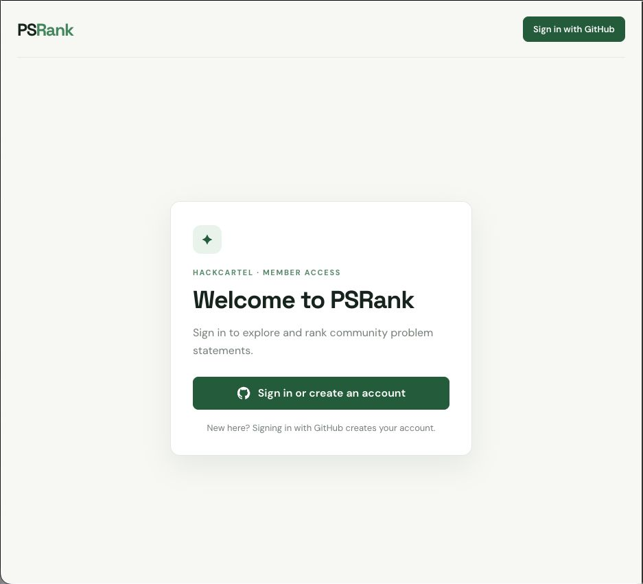
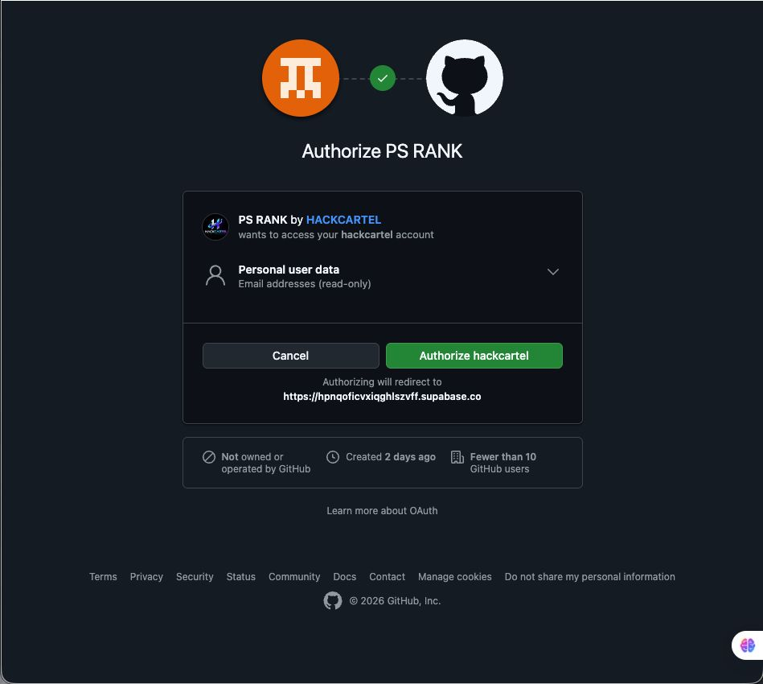
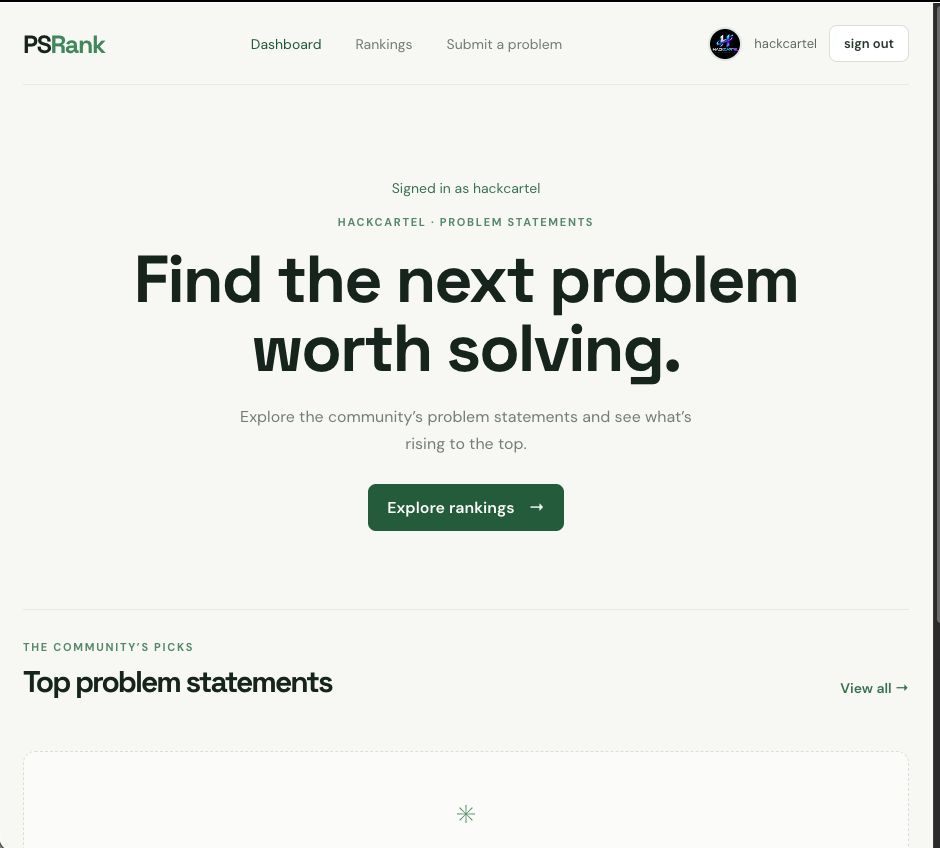
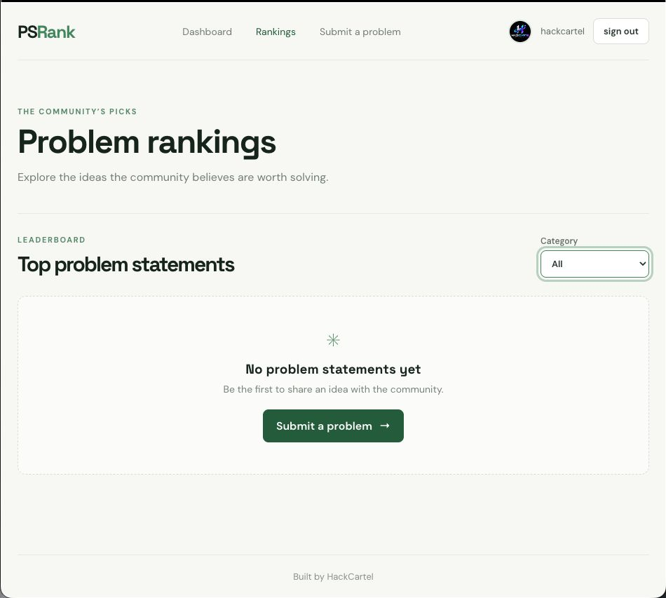
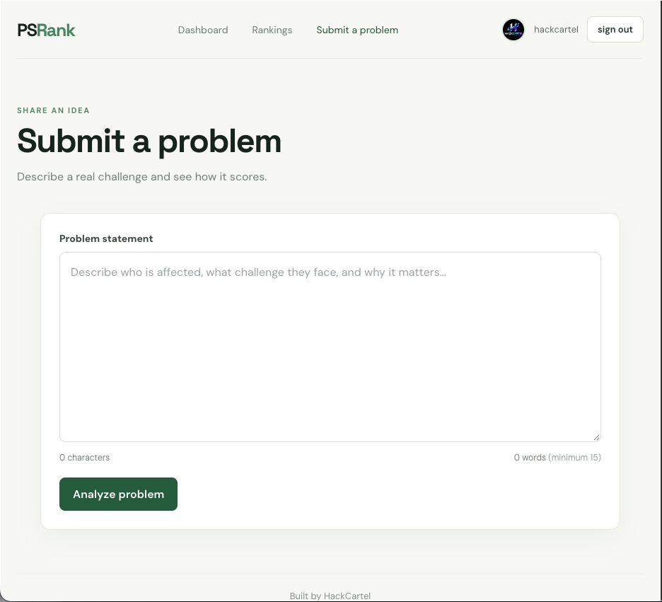
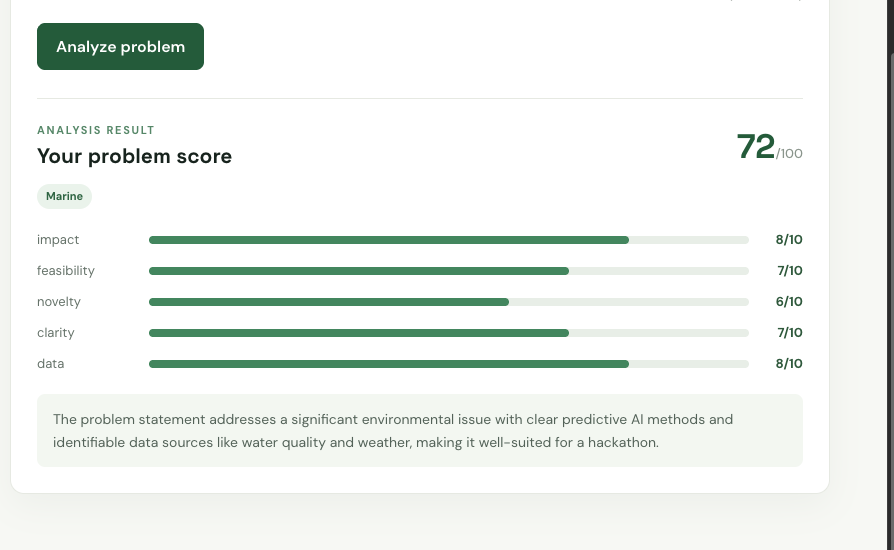

# PSRank

**Problem Statement Ranking System** is an internal HackCartel platform for submitting, analyzing, and ranking hackathon problem statements.

Members sign in with GitHub, submit one problem statement at a time, receive an analysis score, and view the community leaderboard. PSRank uses Supabase for authentication and data storage, a FastAPI analyzer service for scoring and sorting, and Gemini for AI-assisted scoring when configured.

## Features

- GitHub OAuth sign in through Supabase Auth.
- Authenticated dashboard, submission, and rankings pages.
- One problem statement per submission, with a 15-word minimum.
- Five-part scoring breakdown: impact, feasibility, novelty, clarity, and data.
- Category tagging and optional similar-statement detection in the analyzer.
- Supabase persistence with row-level security.
- Rankings sorted by score, then earlier submission time, then ID.
- Gemini scoring with a rule-based fallback if Gemini is unavailable or not configured.
- Category filter on the rankings page.

## Application flow

```text
Member → GitHub sign in via Supabase → Submit a problem statement
       → FastAPI analyzer → Save analysis in Supabase
       → Rank saved statements → View rankings
```

## Technology

- Frontend: React 19, Vite 8
- Authentication and database: Supabase
- OAuth provider: GitHub
- Analyzer and ranking API: Python, FastAPI
- AI scoring: Gemini API (server-side)
- Local similarity comparison: scikit-learn TF-IDF and cosine similarity

## Repository layout

```text
.
├── analyzer/                 # FastAPI analyzer and ranking API
│   ├── analyze.py
│   ├── api.py
│   ├── ranking.py
│   ├── requirements.txt
│   └── .env.example
└── psrank/                   # React + Vite application
    ├── src/
    ├── docs/                 # UI screenshots
    ├── .env.example
    └── package.json
```

## Requirements

- Node.js and npm
- Python 3.10 or newer
- A Supabase project
- A GitHub OAuth App configured as a Supabase provider
- A Gemini API key from [Google AI Studio](https://aistudio.google.com/apikey) (optional; rule-based scoring works without it)

## Run locally

Run the frontend and analyzer in separate terminals from the repository root.

### 1. Configure Supabase and GitHub OAuth

1. Create or use the team Supabase project.
2. In **Authentication → Sign In / Providers**, enable GitHub and enter the GitHub OAuth App client ID and client secret.
3. In the GitHub OAuth App settings, use the Supabase callback URL as its **Authorization callback URL**:

   ```text
   https://YOUR_PROJECT_REF.supabase.co/auth/v1/callback
   ```

4. In Supabase **Authentication → URL Configuration**, set the local site URL to `http://localhost:5173` and add it to the allowed redirect URLs. Add the deployed frontend URL there when deploying.
5. Create the `public.problem_statements` table and policies below if the team project does not already have them.

The GitHub authorization page is normally shown the first time a user authorizes PSRank. Later sign ins can skip that consent screen while the authorization remains active.

### 2. Create the Supabase table and RLS policies

Run this SQL once in the Supabase SQL Editor for a new project. If the table or policies already exist, check them before creating duplicates.

```sql
create table public.problem_statements (
  id uuid primary key default gen_random_uuid(),
  user_id uuid not null references auth.users(id) on delete cascade,
  text text not null,
  score integer not null check (score between 0 and 100),
  category text not null,
  breakdown jsonb not null default '{}'::jsonb,
  "similar" jsonb not null default '[]'::jsonb,
  reason text not null default '',
  created_at timestamptz not null default now()
);

alter table public.problem_statements enable row level security;

create policy "Authenticated users can view problem statements"
  on public.problem_statements
  for select to authenticated
  using (true);

create policy "Users can insert their own problem statements"
  on public.problem_statements
  for insert to authenticated
  with check (auth.uid() = user_id);

grant select, insert on public.problem_statements to authenticated;
```

The frontend uses the Supabase publishable key, with RLS enforcing access. Do not put a Supabase service-role key in the frontend.

### 3. Configure and run the analyzer API

From the repository root, create and activate a virtual environment, then install dependencies:

**macOS / Linux**

```bash
python3 -m venv .venv
source .venv/bin/activate
python -m pip install -r analyzer/requirements.txt
cp analyzer/.env.example analyzer/.env
```

**Windows PowerShell**

```powershell
python -m venv .venv
.venv\Scripts\Activate.ps1
python -m pip install -r analyzer\requirements.txt
Copy-Item analyzer\.env.example analyzer\.env
```

Open `analyzer/.env` and set `GEMINI_API_KEY`. `GEMINI_MODEL` defaults to `gemini-3.8-flash`; set it to a model available to your AI Studio project if needed. Keep this file private. It is ignored by Git. The Gemini key must only be used by the backend, never in a `VITE_` variable.

Start the API from the repository root:

```bash
python -m uvicorn analyzer.api:app --reload --port 8000
```

Check that the API is running at [http://127.0.0.1:8000/health](http://127.0.0.1:8000/health). Interactive API documentation is available at [http://127.0.0.1:8000/docs](http://127.0.0.1:8000/docs).

If Gemini is overloaded or unavailable, the analyzer retries temporary 429/503 errors and then returns a rule-based score. The API reason field indicates when fallback scoring was used. Problem statement text is sent to Gemini when a Gemini key is configured; review your organization’s data requirements before enabling it.

### 4. Configure and run the frontend

Open a second terminal:

```bash
cd psrank
npm install
cp .env.example .env.local
```

On Windows PowerShell, use `Copy-Item .env.example .env.local` in place of the `cp` command.

Set these values in `psrank/.env.local`:

```env
VITE_SUPABASE_URL=https://YOUR_PROJECT_REF.supabase.co
VITE_SUPABASE_PUBLISHABLE_KEY=YOUR_SUPABASE_PUBLISHABLE_KEY
VITE_ANALYZER_API_URL=http://localhost:8000
```

Get the Supabase URL and publishable key from the team’s Supabase project settings. Save the file, then start Vite:

```bash
npm run dev
```

Open the local URL printed by Vite (normally [http://localhost:5173](http://localhost:5173)). Keep both the analyzer and frontend terminals running during local use.

## How analysis and ranking work

1. A signed-in member enters one statement in **Submit a problem**. The form requires at least 15 words.
2. The frontend sends the text to `POST /analyze`.
3. The analyzer asks Gemini for scores from 0 to 10 for five criteria. It calculates the total out of 100 using the configured weights: impact 30%, feasibility 25%, novelty 20%, clarity 15%, and data 10%.
4. The analyzer assigns a category using its keyword rules. It can also compare the statement with supplied existing statements using TF-IDF similarity.
5. The frontend saves the score, category, breakdown, similar results, reason, user ID, and submission time in Supabase.
6. Rankings loads saved statements from Supabase and sends them to `POST /rank`. The analyzer orders them by score descending, then earlier submission, then ID. The rankings page can filter by category.

The current submission form handles one statement per submission. Batch entry of multiple statements is not part of the current flow.

## Analyzer API

### `GET /health`

Returns API status:

```json
{"status":"ok"}
```

### `POST /analyze`

Request:

```json
{
  "problem": "Farmers in remote villages often lack timely soil and crop information, making it difficult to decide when to irrigate."
}
```

Optional `existing_problems` may contain objects with `id` and `text` fields for similarity comparison. The response includes `score`, `breakdown`, `category`, `similar`, and `reason`.

### `POST /rank`

Request:

```json
{
  "items": [
    {"id": "example-id", "score": 78, "category": "Agriculture", "created_at": "2026-11-05T10:00:00Z"}
  ],
  "category": null,
  "top_n": null
}
```

The response contains the sorted `items`, each with a `rank` field. `category` and `top_n` are optional filters.

## Useful commands

From `psrank/`:

```bash
npm run dev       # Start the frontend
npm run build     # Build production assets
npm run preview   # Preview the production build
npm run lint      # Run Oxlint
```

From the repository root, to run the analyzer tests:

```bash
python -m unittest discover -s analyzer -v
```

## Configuration and deployment notes

- `.env.local` and `analyzer/.env` contain local secrets/settings and must not be committed.
- The Supabase publishable key is intended for the browser; database access must remain protected by RLS policies.
- The Gemini key is a backend secret. Configure it as an environment variable on the API host during deployment.
- Set `VITE_ANALYZER_API_URL` to the deployed analyzer URL when building the frontend.
- Set the analyzer’s `ALLOWED_ORIGINS` environment variable to the deployed frontend origin. By default, local CORS allows `http://localhost:5173` and `http://127.0.0.1:5173`.
- Add the deployed frontend URL to Supabase Auth’s allowed redirect URLs.
- The app and API are currently configured for local development; hosting and production URLs must be configured before public deployment.

## Screenshots

The following screenshots :









## License

This project is developed for the HackCartel internal hackathon. Add a license before reusing or redistributing the code outside the project.
